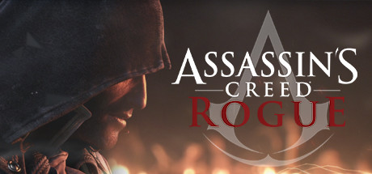

**Assassin's Creed Rogue follows Shay Patrick Cormac switching sides from Assassin to Templar after a traumatic mission in Lisbon. The unique perspective of hunting former brothers creates a compelling moral story alongside the familiar AC naval formula.**

---

## 📖 About

Assassin's Creed Rogue follows Shay Patrick Cormac switching sides from Assassin to Templar after a traumatic mission in Lisbon. The unique perspective of hunting former brothers creates a compelling moral story alongside the familiar AC naval formula.

## ⚠️ Problems Without Trainer

| Problem | Status |
|---------|--------|
| **Assassin Ambush Frequency** — Assassin attacks are relentless and interrupt exploration constantly | ✅ Solved |
| **Arctic Navigation** — Ice navigation sections require managing ship temperature carefully | ✅ Solved |
| **Shockwave Air Rifle** — Mastering the new weapon requires experimentation with usage | ✅ Solved |
| **Collectible Overlap** — Shares collectible structure with Black Flag without significant variation | ✅ Solved |

## ✅ Solution

The **Assassin's Creed Rogue Trainer** solves all these issues by giving you complete control over the game.

## 🎯 Full Feature List

- Unlimited Resources
- God Mode / Invincibility
- Instant Skill Cooldown
- One-Hit Kill
- Freeze Game Timer
- Unlock All Items & Achievements
- Custom Speed Multiplier
- Save State Anywhere

## 🚀 Quick Start

1. **Disable Windows Defender** temporarily (trainer may trigger false positive)
2. Download the trainer from the button above
3. Launch Assassin's Creed Rogue
4. Run the trainer as Administrator
5. Activate desired cheats with hotkeys

## 💎 Free vs Paid

| Feature | Free | Pro |
|---------|------|-----|
| Basic God Mode | ✅ | ✅ |
| Unlimited Resources | ✅ | ✅ |
| All Advanced Cheats | ❌ | ✅ |
| Auto-Updates | ❌ | ✅ |
| Priority Support | ❌ | ✅ |

## 💻 Requirements

- Windows 10/11 (64-bit)
- Assassin's Creed Rogue (any version)
- .NET Framework 4.8+
- DirectX 11+

## 🍎 macOS

macOS users can use our alternative tool:

## ⚖️ Legal

This trainer is for educational and single-player use only. Use responsibly.

---

